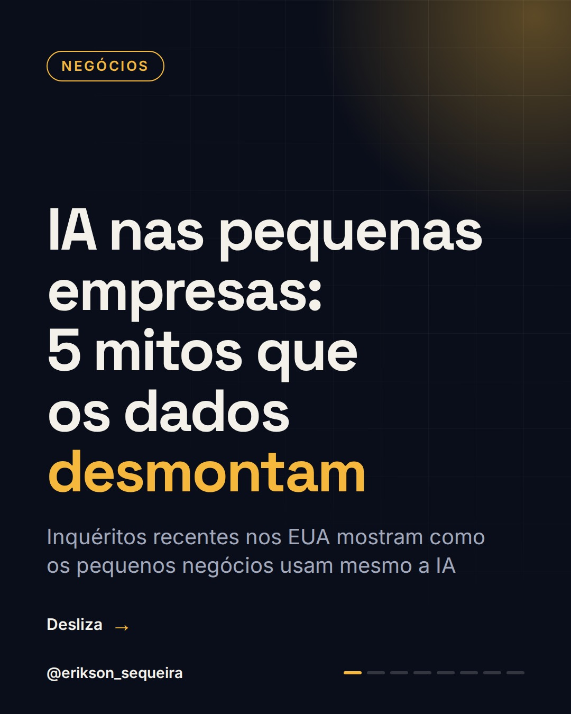
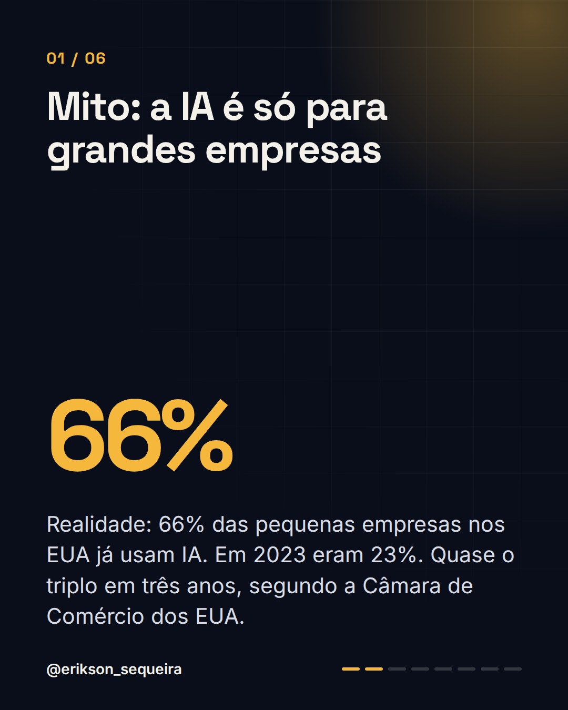
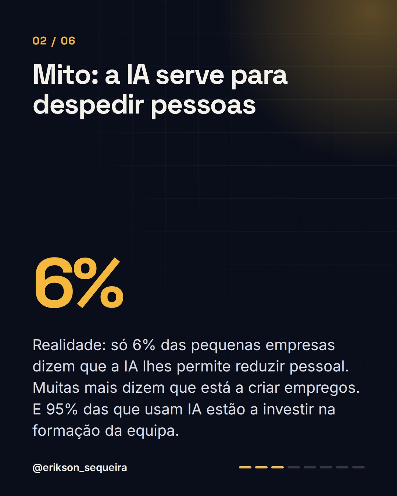
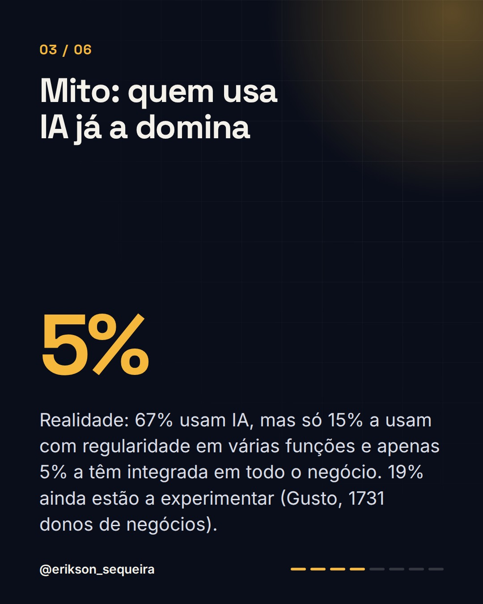
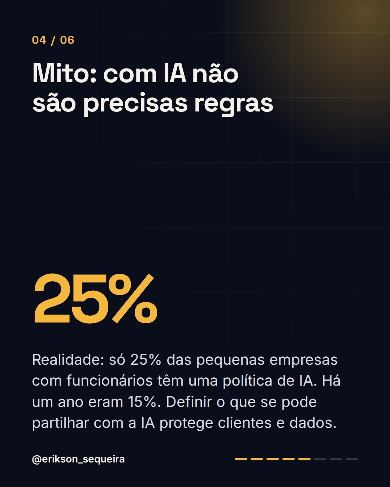
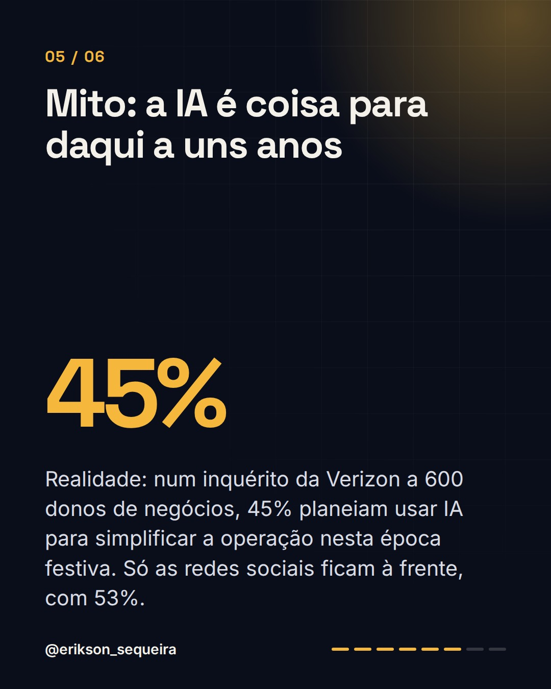

**Mitos sobre IA nas pequenas empresas desmontados por inquéritos recentes (Câmara de Comércio EUA, Gusto, Verizon)** · pilar `negocios` · formato `mito-realidade`









### Legenda

```
A IA não é um luxo das grandes empresas. Os números mais recentes mostram o contrário.

Nos EUA, dois terços das pequenas empresas já usam IA. Mas há um detalhe que quase ninguém comenta: usar não é o mesmo que tirar partido. Segundo o relatório da Gusto, a maioria ainda está a experimentar ou a usar IA em tarefas soltas. Só uma pequena minoria a integrou a sério no negócio.

E isso é uma boa notícia para quem está a começar. A corrida ainda vai no início.

O que separa quem experimenta de quem cresce:
1. Escolhe um problema concreto. Ex.: responder mais depressa a clientes, preparar orçamentos, criar conteúdo para as redes.
2. Mede o tempo poupado. Se não poupas tempo nem ganhas vendas, muda de ferramenta ou de tarefa.
3. Define regras. Que dados de clientes nunca entram numa ferramenta de IA? Quem revê o que sai?
4. Forma a equipa. Segundo a Câmara de Comércio dos EUA, quase todas as pequenas empresas que usam IA estão a investir na formação das pessoas.

Para quem está nos PALOP, seja um alojamento turístico, uma loja que vende pelo WhatsApp ou uma consultora, a pergunta não é "se" mas "por onde começar". Como empreendedor cabo-verdiano, vejo a IA como uma forma de equipas pequenas competirem com estruturas maiores, desde que haja disciplina no uso.

Qual seria a primeira tarefa que entregavas à IA no teu negócio?

Guarda este post e partilha com quem ainda acha que a IA "não é para pequenos".

Fonte: U.S. Chamber of Commerce, Gusto (via CPA Practice Advisor), Verizon

#inteligenciaartificial #pequenasempresas #empreendedorismo #negociosdigitais #palop
```

### Fontes verificadas
- https://www.uschamber.com/technology/2026-empowering-small-business-report
- https://www.uschamber.com/economy/the-chambers-free-enterprise-opportunity-tour-rolls-into-detroit-with-groundbreaking-new-data-on-how-ai-is-creating-small-business-jobs
- https://www.manilatimes.net/2026/11/25/tmt-newswire/globenewswire/us-chamber-of-commerce-report-ai-is-creating-small-business-jobs-not-just-replacing-them-in-discussion-with-yourupdatetv/2477559
- https://www.cpapracticeadvisor.com/2026/11/12/small-business-owners-are-more-confident-in-their-own-companies-than-in-the-economy-and-two-thirds-use-ai/193807/
- https://www.verizon.com/about/news/verizon-survey-small-businesses-social-media-ai-holidays

---
Comenta **ok** para publicar · **não** para descartar.