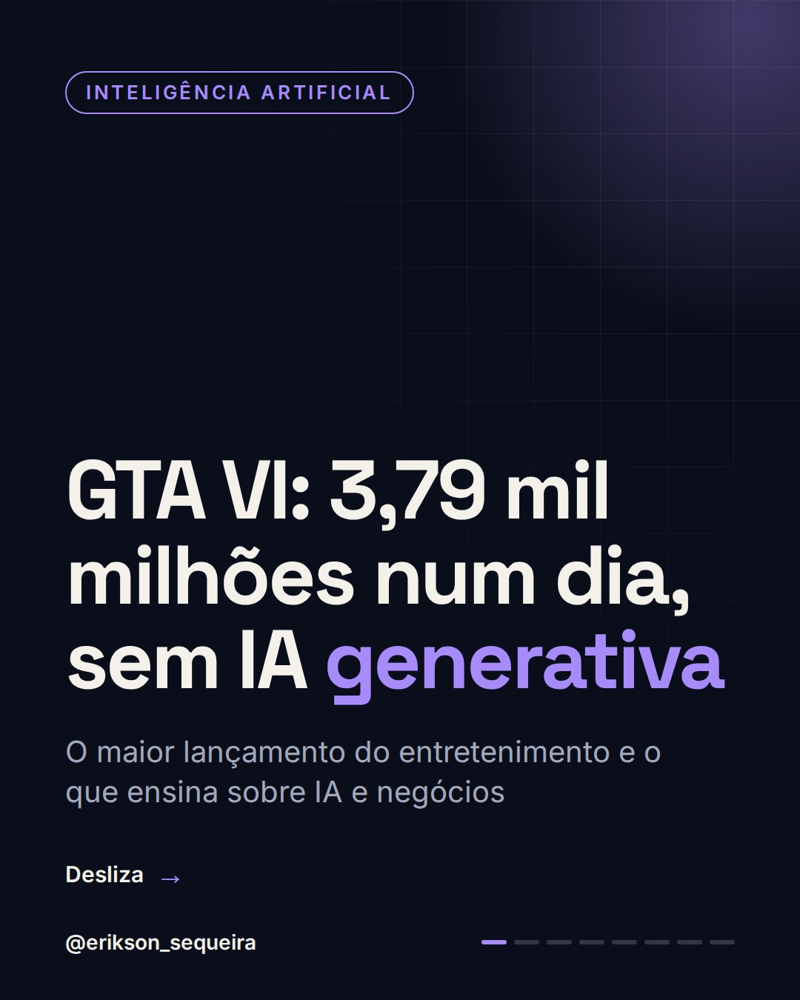
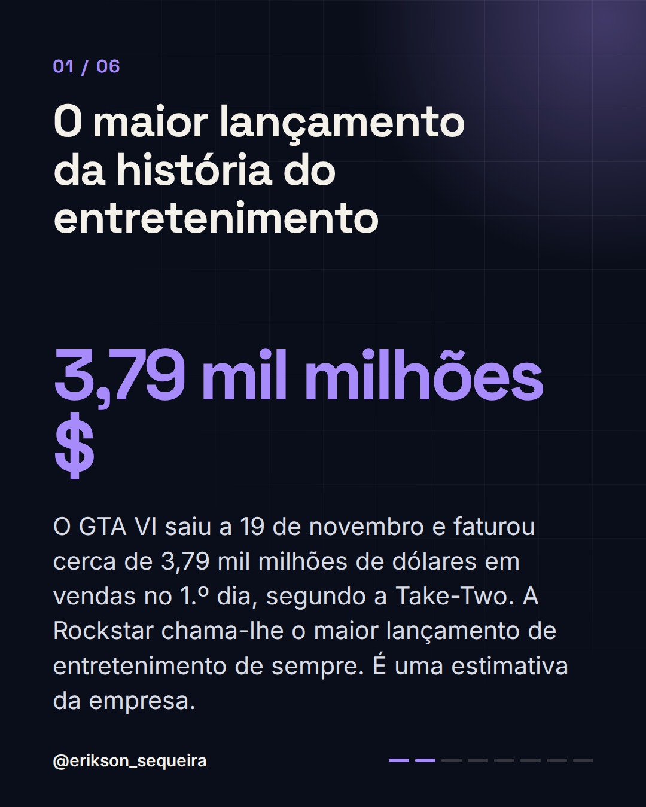
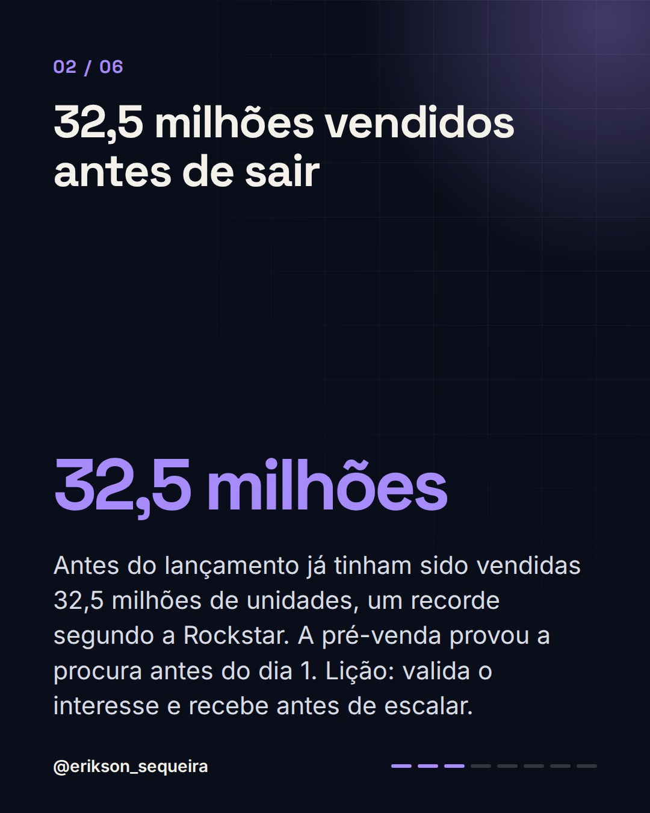
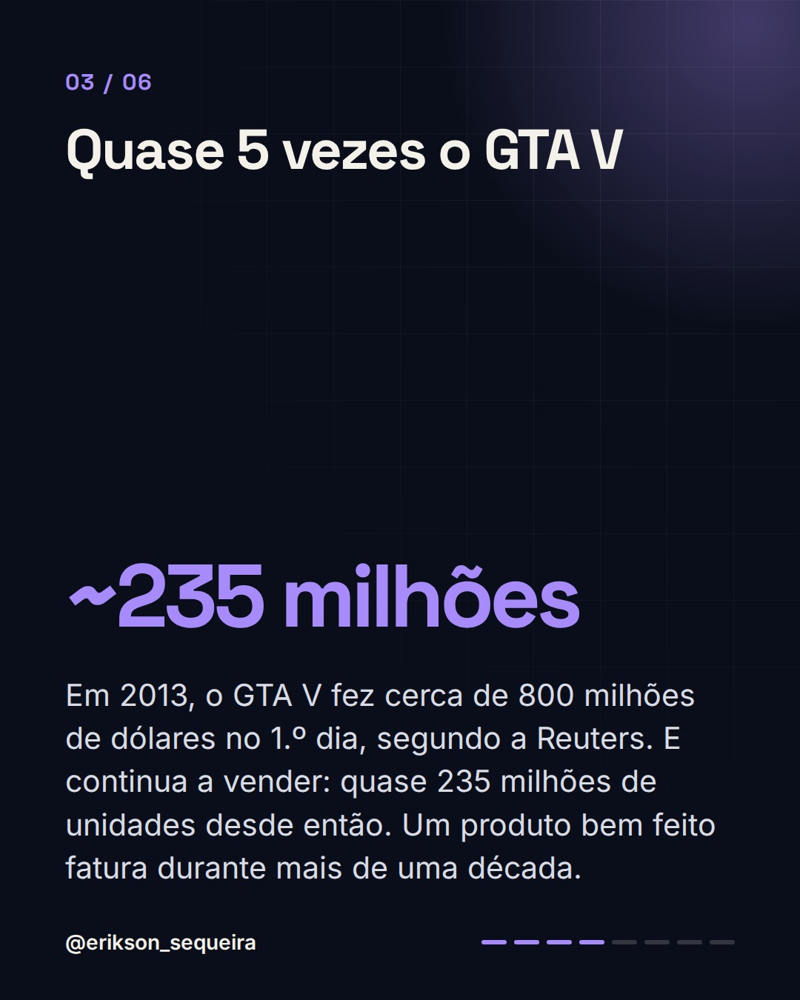
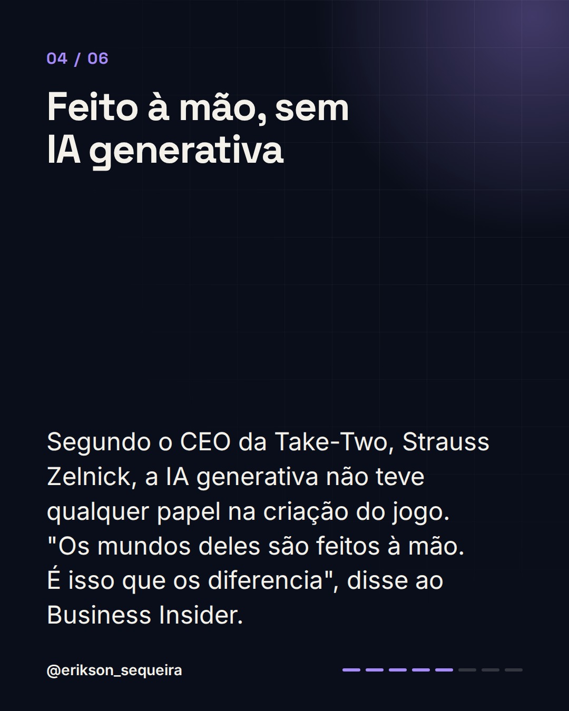
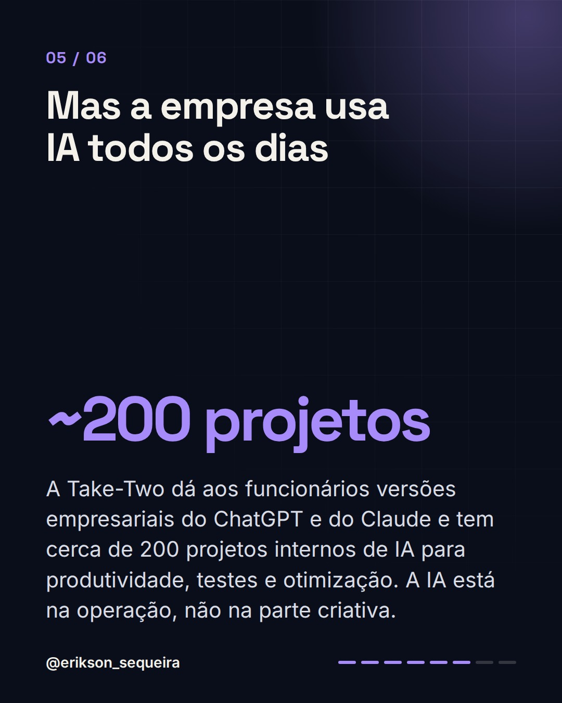
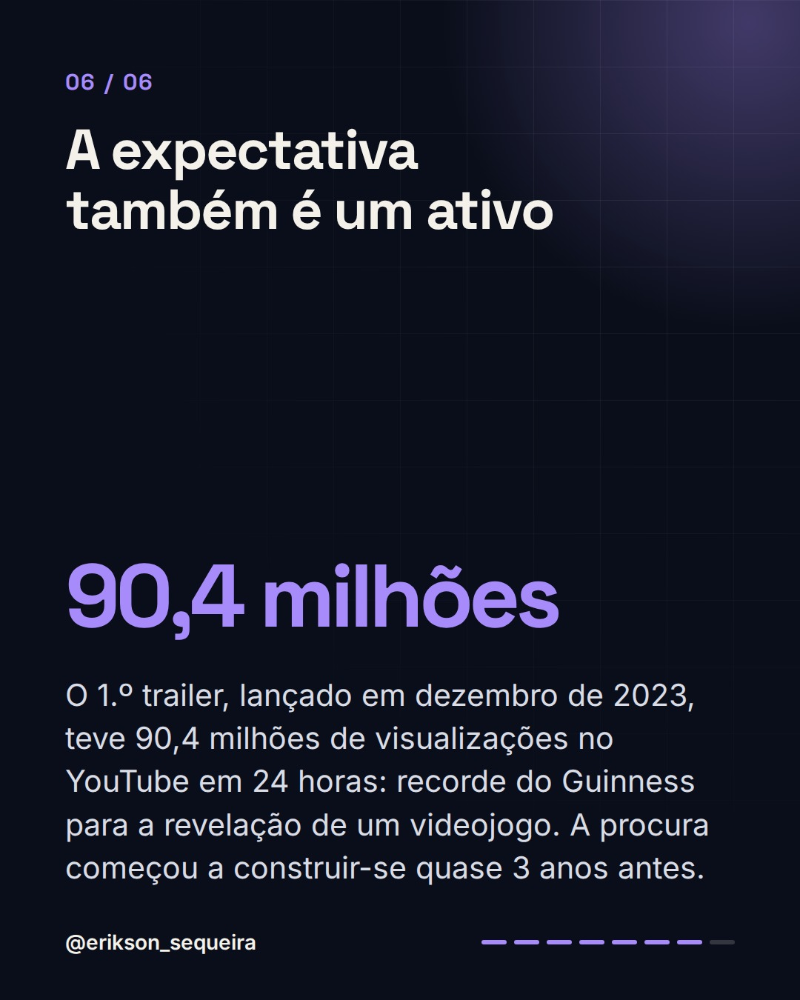
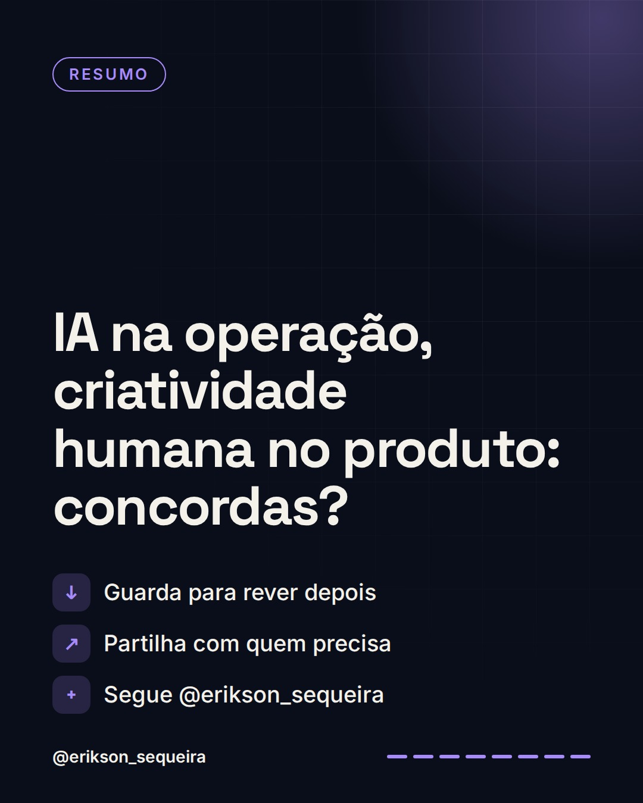

**Lançamento recorde do GTA VI (3,79 mil milhões no 1.º dia), feito sem IA generativa, e lições de IA e negócio** · pilar `ia` · formato `hype`










### Legenda

```
O jogo que bateu todos os recordes do entretenimento foi feito sem IA generativa.

O GTA VI saiu a 19 de novembro e, segundo a Take-Two, faturou cerca de 3,79 mil milhões de dólares em vendas no primeiro dia. Para teres uma ideia, "Vingadores: Endgame" fez cerca de 2,94 mil milhões em toda a carreira nos cinemas. São medidas diferentes, mas a escala é clara. A crítica também ajudou: 99 em 100 no Metacritic.

O mais interessante para quem empreende é como a Take-Two usa a IA. Não é contra a tecnologia: os funcionários têm ChatGPT e Claude e há cerca de 200 projetos internos para testes, produtividade e otimização. Mas a parte que o cliente vê e paga (o mundo, as personagens, a história) continua nas mãos de pessoas.

Esta divisão serve para qualquer negócio, em Cabo Verde, Angola, Moçambique ou Portugal. Usa a IA para responder a e-mails, organizar stock, preparar relatórios ou testar ideias. Mas o que te distingue (o teu serviço, a tua marca, a relação com o cliente) não se copia com uma ferramenta. Como diz o próprio CEO da Take-Two, as ferramentas sozinhas não criam grandes produtos.

Outra lição: 32,5 milhões de unidades vendidas antes do lançamento. Antes de investir tudo, testa a procura com uma pré-venda, mesmo que seja pequena, com pagamento por vinti4, Multicaixa Express ou M-Pesa.

E tu, onde é que já usas IA no teu negócio, e onde é que nunca a usarias? Conta nos comentários.

Guarda este post e partilha com quem está a construir algo.

Fonte: Fox Business, ABC News, Deadline, The Next Web, Push Square

#gta6 #inteligenciaartificial #empreendedorismo #negociosdigitais #palop
```

### Fontes verificadas
- https://www.foxbusiness.com/entertainment/grand-theft-auto-vi-shatters-entertainment-records-staggering-3-79b-debut
- https://abcnews.com/GMA/Culture/grand-theft-auto-vi-breaks-1st-day-sales-record/story?id=138328412
- https://deadline.com/2026/11/gta6-first-day-sales-4-billion-1237230465/
- https://thenextweb.com/news/take-two-gta6-no-generative-ai-handcrafted
- https://pushsquare.com/news/2023/12/gta-6-trailer-pulls-90-million-views-in-24-hours-sets-new-world-records

---
Comenta **ok** para publicar · **não** para descartar.