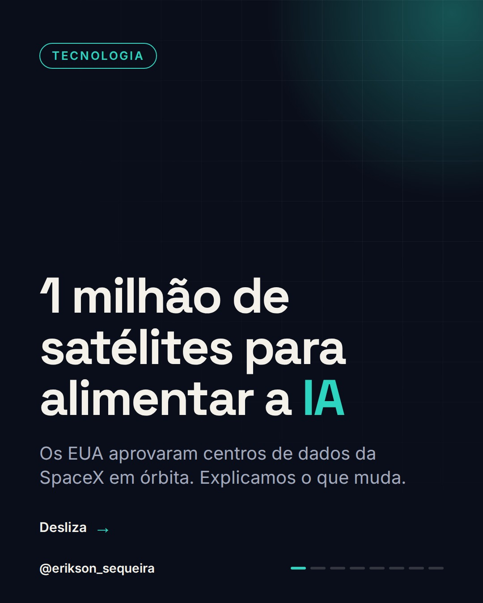
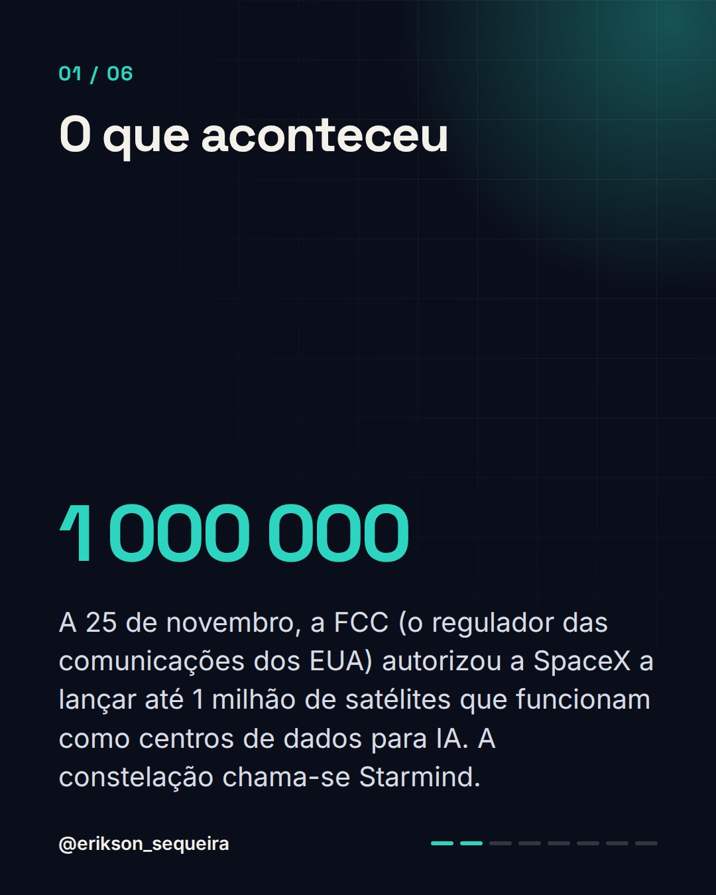
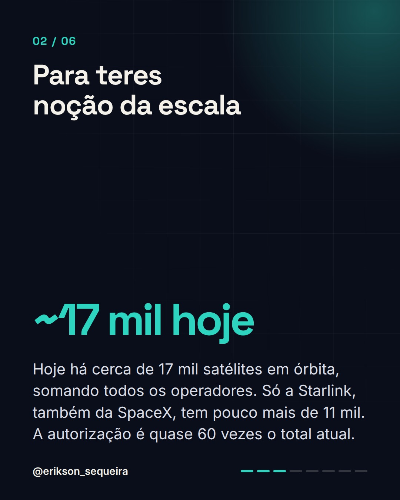
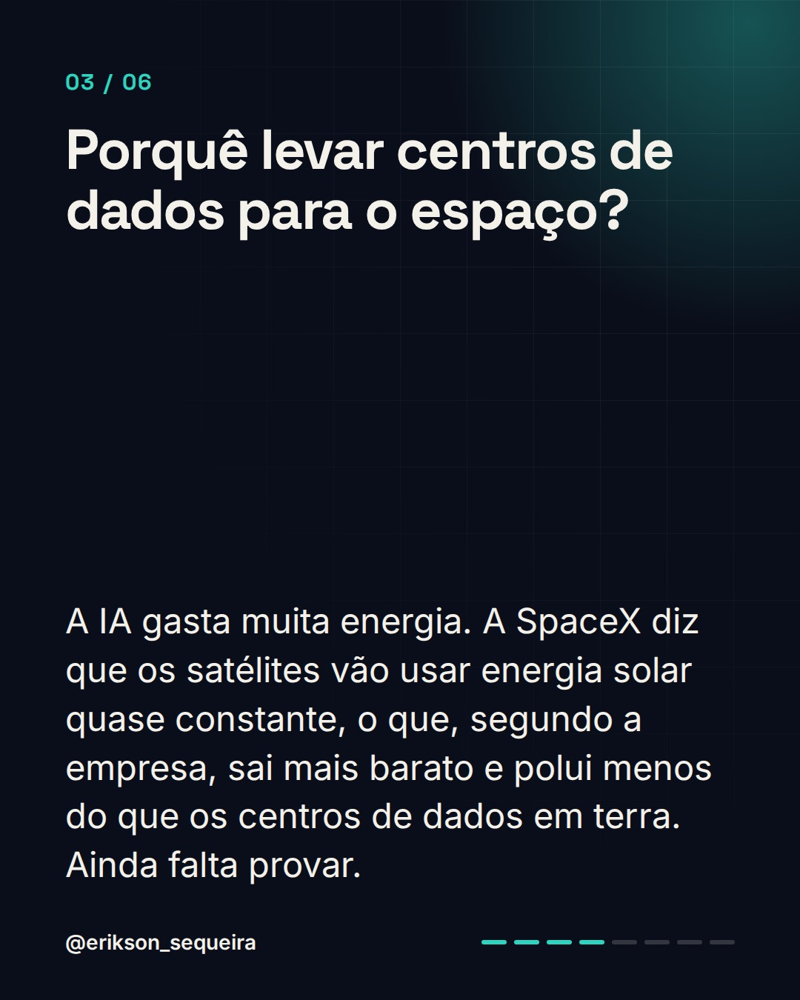
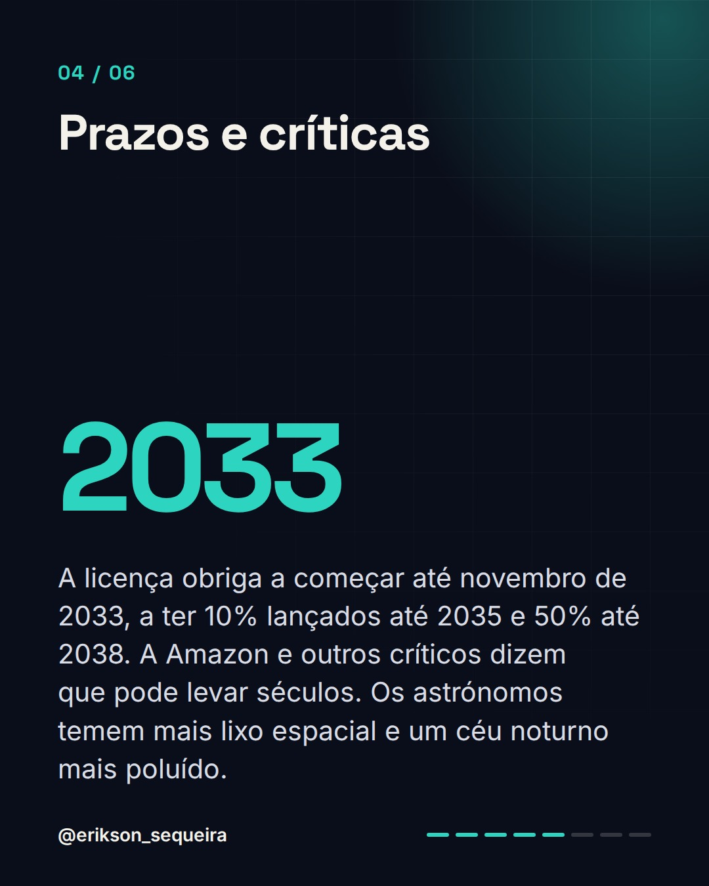
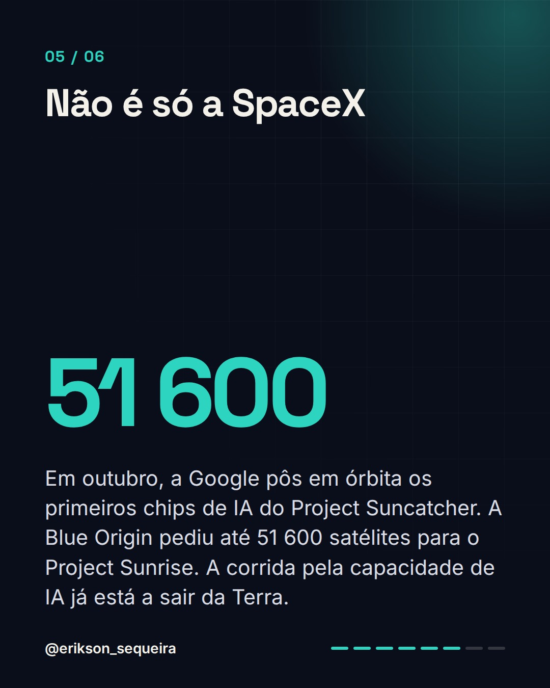

**EUA autorizam a SpaceX a lançar até 1 milhão de satélites-centros de dados de IA (Starmind)** · pilar `tecnologia` · formato `noticia-explicada`









### Legenda

```
Os EUA acabam de autorizar 1 milhão de satélites para fazer funcionar a inteligência artificial.

Na quarta-feira, 25 de novembro, a FCC deu luz verde à constelação Starmind, da SpaceX. Não são satélites de internet como a Starlink. São "módulos de computação em órbita", que processam dados para serem usados na Terra.

O presidente da FCC, Brendan Carr, chamou-lhe "uma nova fronteira ousada" para a infraestrutura de computação. Elon Musk respondeu que será "um grande trunfo para a América e para o mundo".

Nem todos estão convencidos:
→ A Amazon diz que é uma "ambição" e não um plano real.
→ A organização ambiental Earthjustice critica a aprovação sem avaliação ambiental.
→ O plano depende muito da Starship, o foguetão reutilizável da SpaceX que ainda está em desenvolvimento.
→ É comum as empresas pedirem mais satélites do que tencionam lançar, para terem margem.

Esta notícia mostra uma coisa clara. A IA precisa de tanta energia que as maiores empresas do mundo já estão a procurar espaço fora do planeta. Para os PALOP, a lição é prática: os serviços de IA que usamos dependem de infraestrutura que não controlamos. Perceber isto ajuda a fazer melhores escolhas, seja como empresa, estudante ou governo.

Achas que vamos mesmo ver centros de dados no espaço nesta década? Diz-me nos comentários.

Partilha com quem gosta de tecnologia.

Fonte: CNBC, NBC News, Al Jazeera

#tecnologia #inteligenciaartificial #spacex #inovacao #palop
```

### Fontes verificadas
- https://www.cnbc.com/2026/11/25/spacex-fcc-satellite-approval.html
- https://www.nbcnews.com/science/space/spacex-fcc-authorizes-1-million-satellites-data-centers-space-rcna611341
- https://www.aljazeera.com/news/2026/11/25/us-grants-spacex-approval-for-1-million-space-data-centres
- https://www.cnn.com/2026/11/26/business/spacex-satellites-space-data-centers-intl

---
Comenta **ok** para publicar · **não** para descartar.