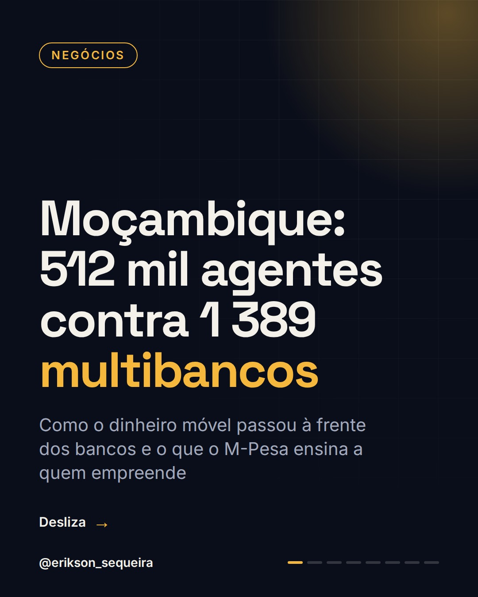
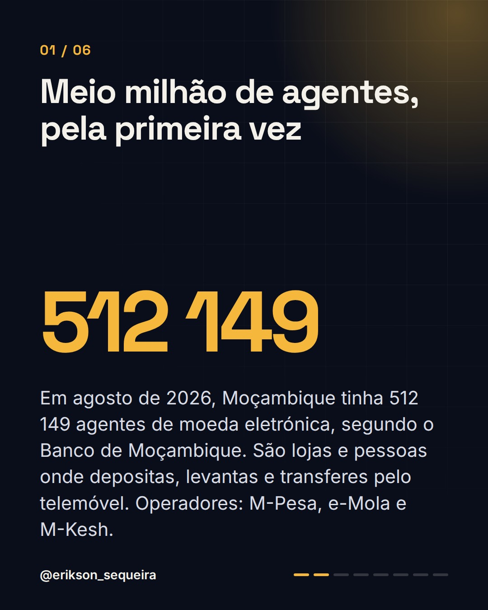
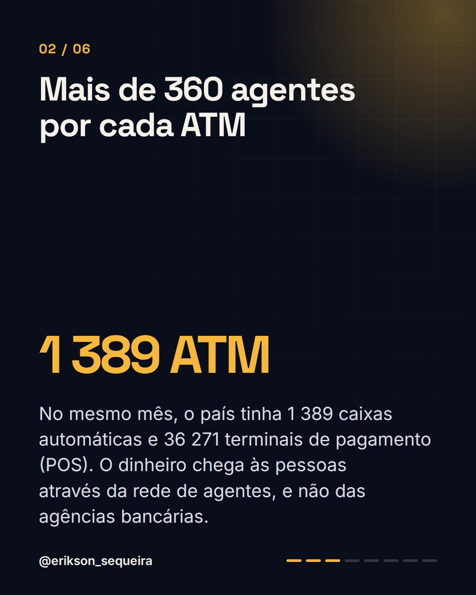
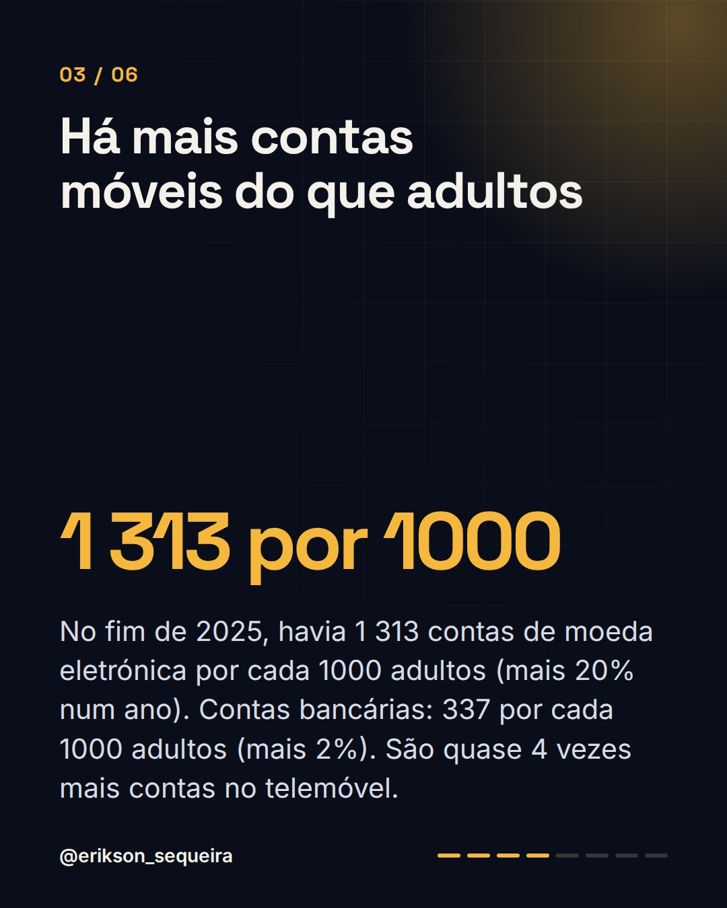
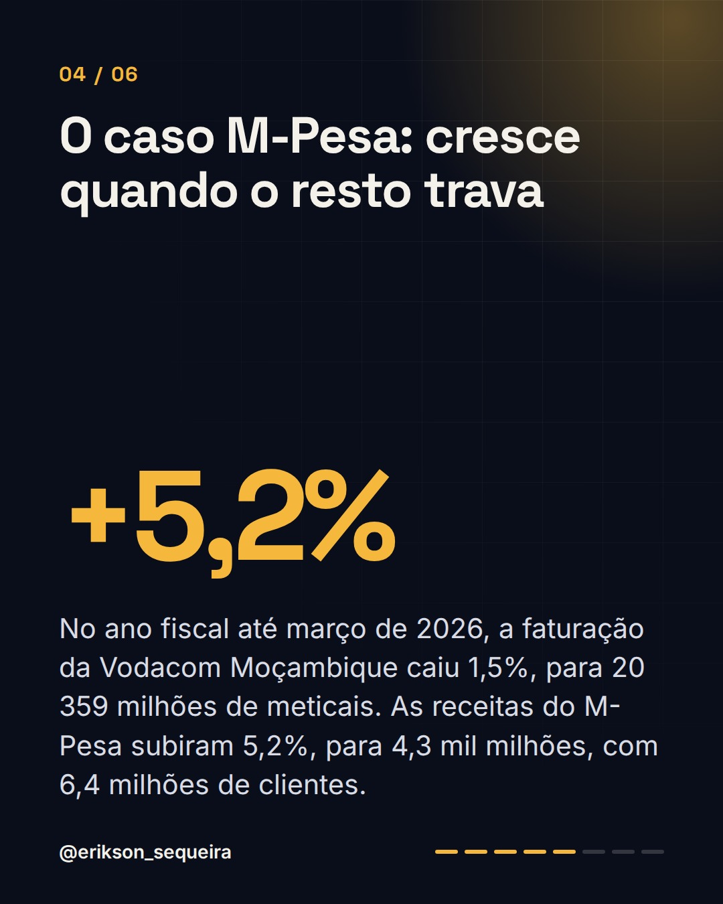
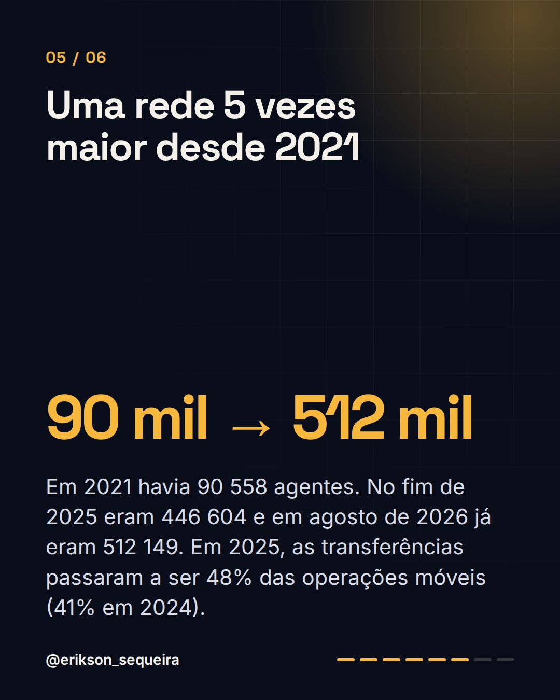
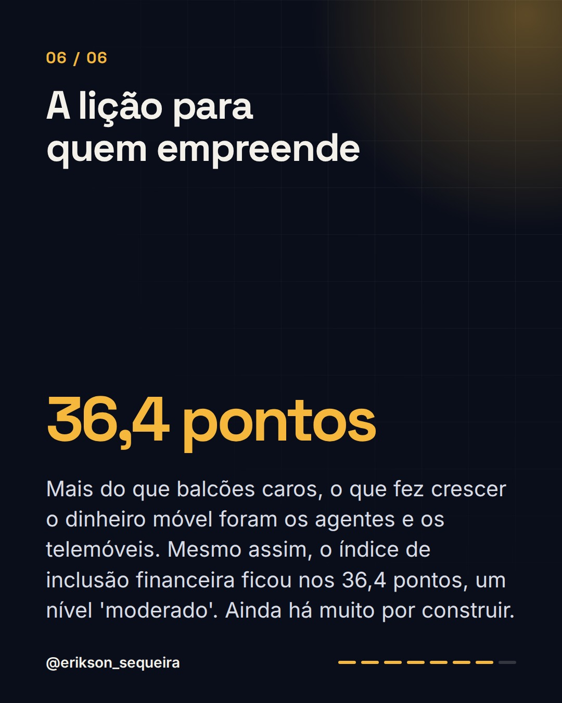

**Moçambique passa os 512 mil agentes de dinheiro móvel e o caso M-Pesa (receitas a crescer enquanto a Vodacom fatura menos)** · pilar `negocios` · formato `caso-de-negocio`










### Legenda

```
Moçambique tem mais de 360 agentes de dinheiro móvel por cada caixa automática.

Os dados são do Banco de Moçambique: em agosto de 2026, a rede de agentes de moeda eletrónica passou pela primeira vez o meio milhão (512 149). Para comparar, o país tinha 1 389 ATM.

O mais interessante é o modelo de negócio. Um agente pode ser a mercearia do bairro, a banca do mercado ou o quiosque da esquina. Não é preciso construir uma agência. O operador junta-se a negócios que já existem e as pessoas usam o telemóvel que já têm.

Os números da Vodacom Moçambique mostram o efeito. No ano fiscal até março de 2026, a faturação total caiu 1,5%, mas as receitas do M-Pesa subiram 5,2%, para 4,3 mil milhões de meticais. Foi o serviço financeiro que continuou a crescer quando o negócio principal abrandou.

Há também um alerta: o índice de inclusão financeira do país não mexeu e ficou nos 36,4 pontos. Ter uma conta não é o mesmo que ter acesso a crédito, poupança ou seguros. É aí que está a próxima oportunidade para startups e fintechs.

Nos PALOP, a tendência é parecida, com o vinti4 em Cabo Verde, o Unitel Money em Angola e o Orange Money em vários mercados. Quem constrói em cima destas redes chega a mais clientes, e mais depressa.

E tu, pagas mais com o telemóvel ou em dinheiro vivo? Conta nos comentários.

Partilha com quem precisa de perceber para onde está a ir o dinheiro em África.

Fonte: Banco de Moçambique (via Lusa/Diário Económico), Executive Digest, Telecompaper

#mocambique #mpesa #dinheiromovel #fintech #empreendedorismo
```

### Fontes verificadas
- https://www.diarioeconomico.co.mz/2026/11/25/economia/mocambique-ultrapassa-meio-milhao-de-agentes-de-moeda-electronica-pela-primeira-vez/
- https://executivedigest.sapo.pt/mocambique-ultrapassa-marca-de-meio-milhao-de-agentes-de-carteira-movel-nas-ruas/
- https://executivedigest.sapo.pt/vodacom-com-quebra-na-faturacao-em-mocambique-apesar-de-melhoria-operacional/
- https://www.telecompaper.com/news/vodacom-mozambique-posts-15-fall-in-annual-revenues--1579987

---
Comenta **ok** para publicar · **não** para descartar.