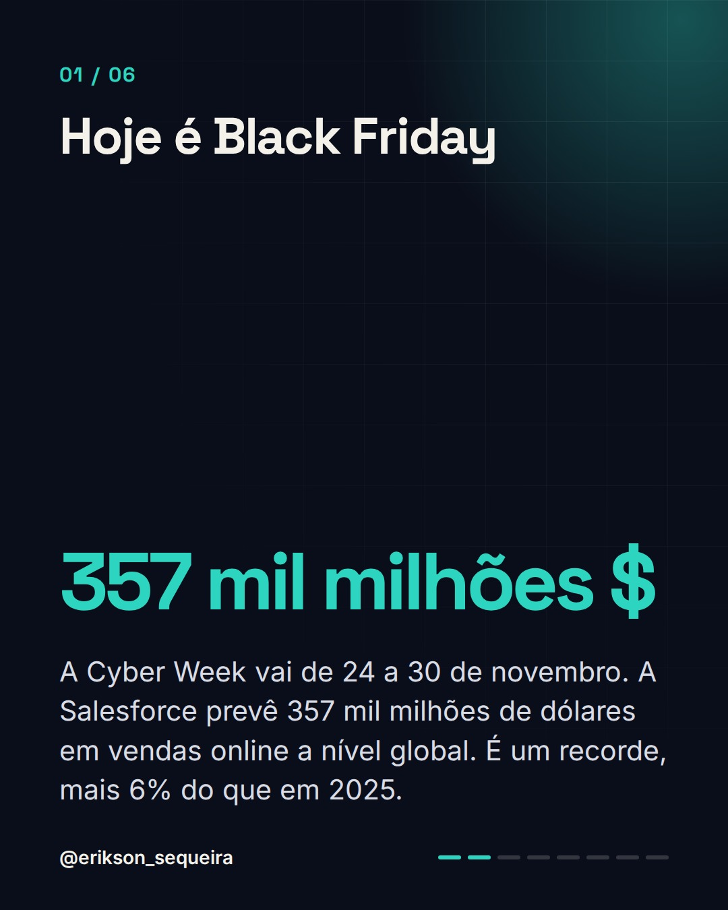
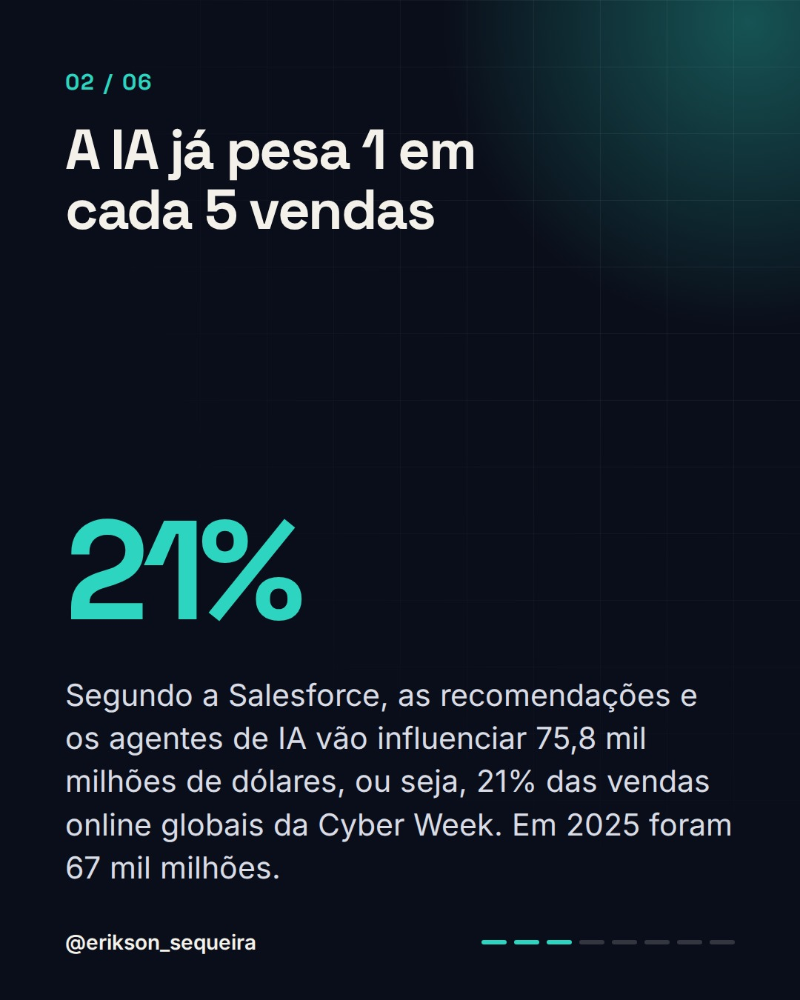
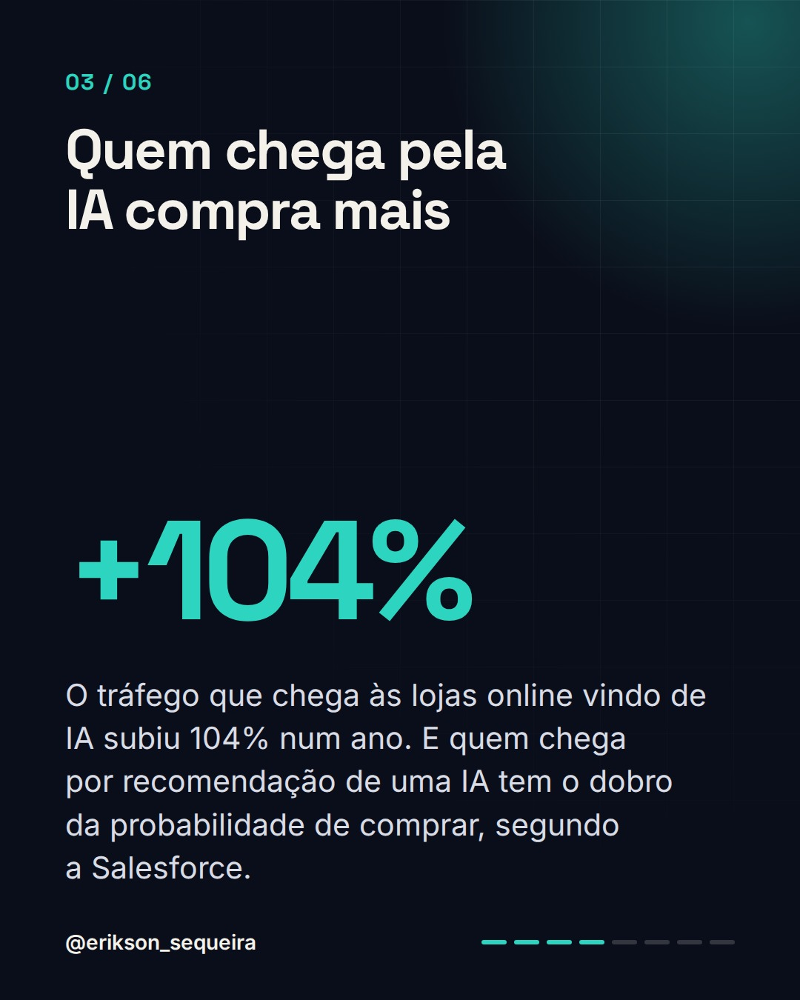
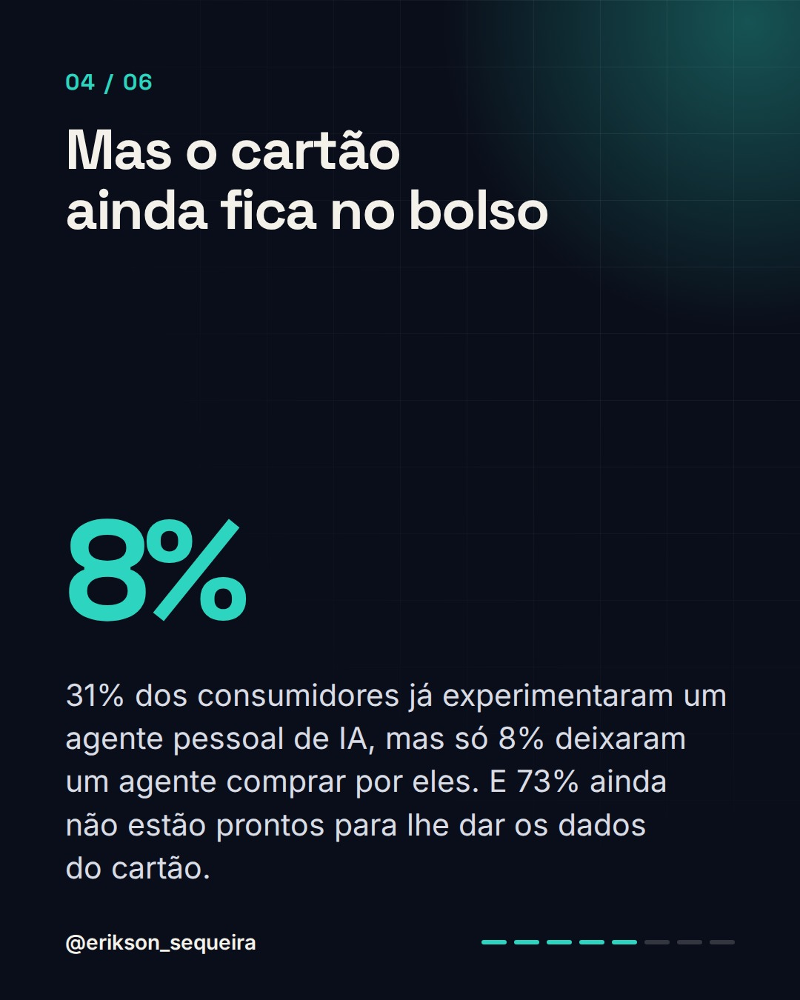
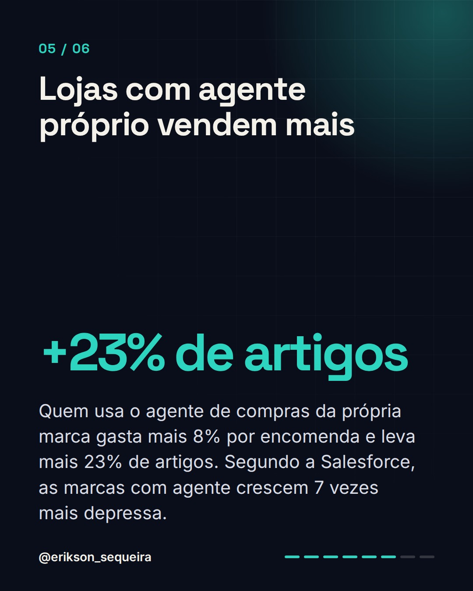

**Black Friday/Cyber Week 2026: a IA influencia 21% das vendas online (Salesforce) e lições para quem vende** · pilar `tecnologia` · formato `hype`









### Legenda

```
Esta Black Friday, muita gente vai comprar o que uma IA lhe recomendou.

Hoje é Black Friday, um dos dias mais fortes da Cyber Week. Nos EUA, a Adobe prevê 12,9 mil milhões de dólares em vendas online só hoje (mais 9,2% do que em 2025) e 15,1 mil milhões na Cyber Monday, que seria um recorde para um só dia. O Dia de Ação de Graças já tinha chegado aos 7,1 mil milhões.

O dado mais interessante não é o volume. É a forma como se compra. Segundo a Adobe, o tráfego que chega às lojas americanas vindo de ferramentas de IA subiu 159% no Dia de Ação de Graças. A Salesforce estima que 1 em cada 5 consumidores começa as compras de Natal com uma IA.

Mas atenção: a IA influencia a compra e a decisão final continua a ser da pessoa. Só 8% já deixaram um agente pagar por eles.

A lição para quem vende, seja em Praia, Luanda ou Maputo: a montra já não é só o Instagram ou o WhatsApp. É também a resposta que uma IA dá quando alguém pergunta "qual é a melhor opção?". Preços visíveis, descrições completas e informação atualizada passam a contar como marketing.

Como empreendedor cabo-verdiano, vejo aqui uma oportunidade: os pequenos negócios que organizarem bem a informação agora chegam primeiro a este novo canal.

E tu, confiavas numa IA para escolher um presente por ti? Diz-me nos comentários.

Guarda este post e partilha com quem vende online.

Fonte: Salesforce, Adobe (via Yahoo Finance)

#blackfriday #inteligenciaartificial #ecommerce #empreendedorismo #palop
```

### Fontes verificadas
- https://www.salesforce.com/news/stories/cyber-week-ai-sales-2026/
- https://finance.yahoo.com/technology/ai/articles/adbe-stock-track-4-day-173901382.html
- https://techresearchonline.com/news/black-friday-online-sales/

---
Comenta **ok** para publicar · **não** para descartar.