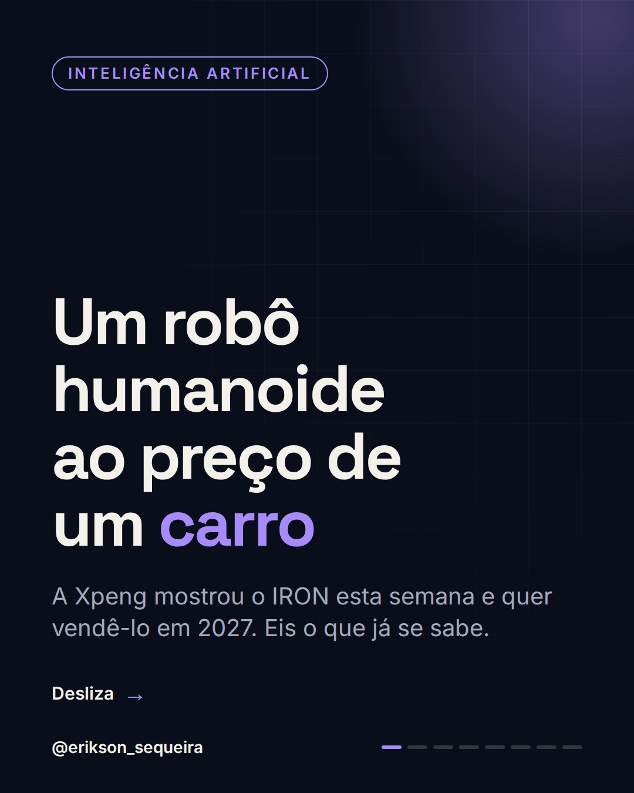
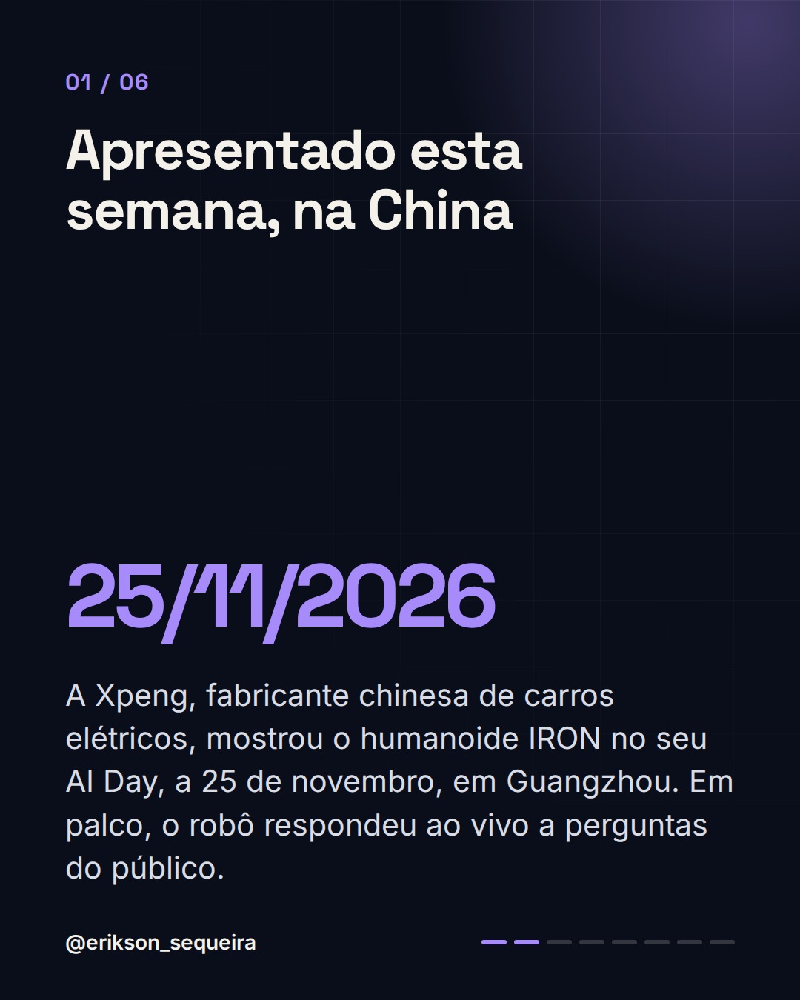
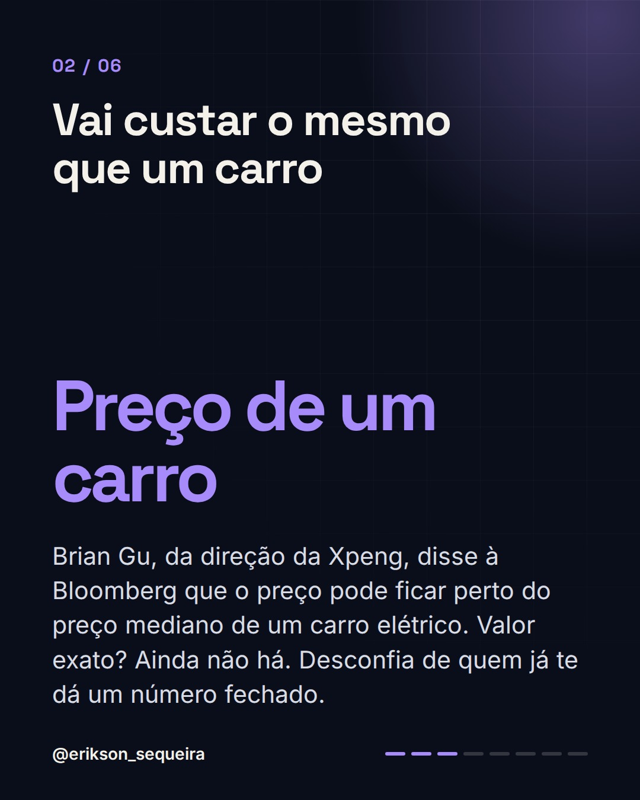
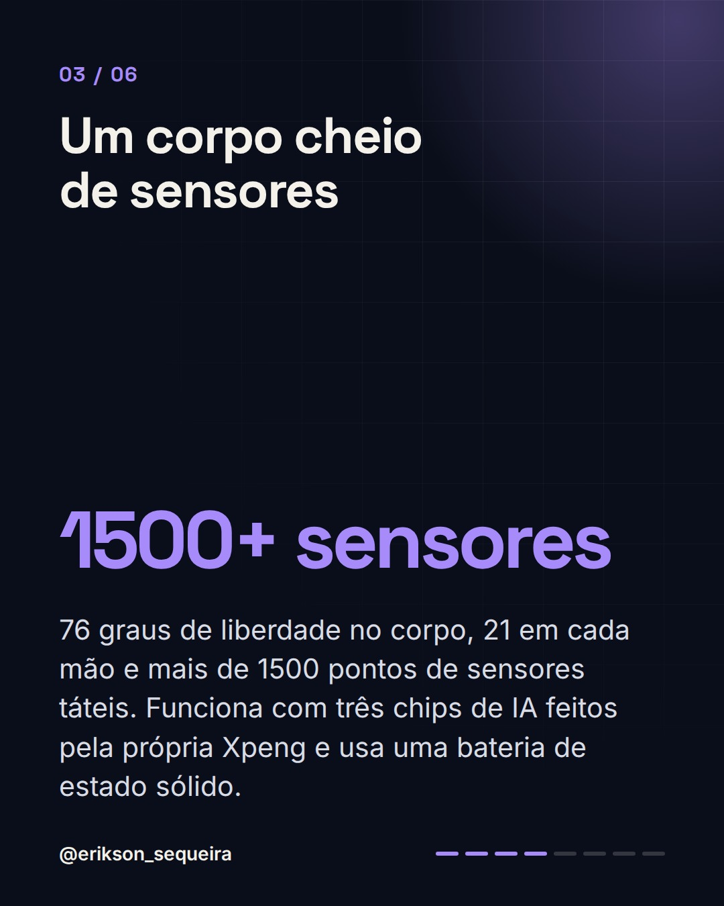
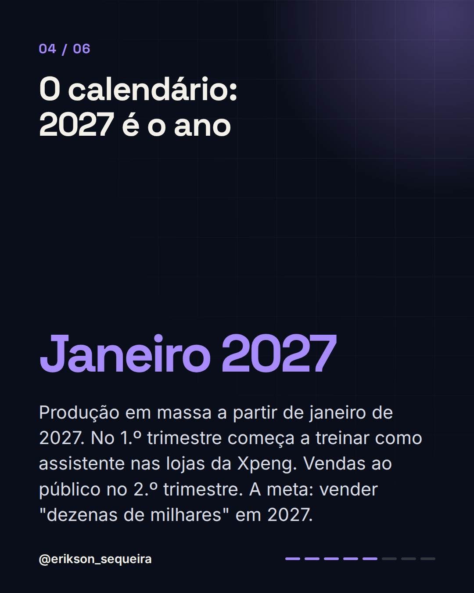
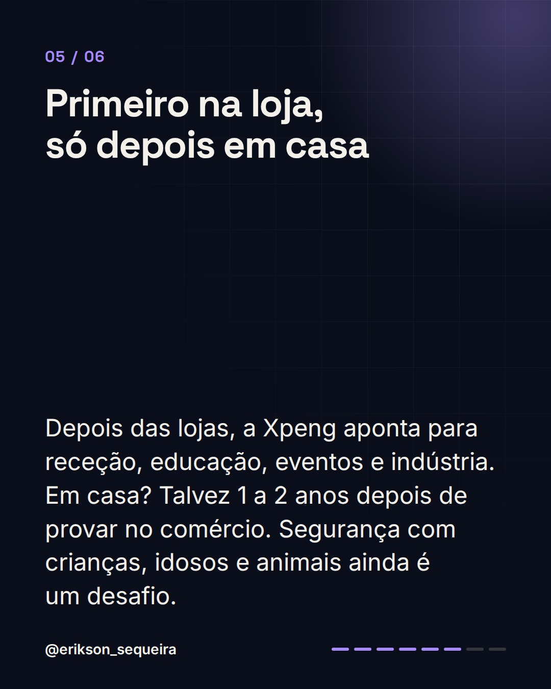

**Robô humanoide IRON da Xpeng (AI Day 25/11/2026): preço perto do de um carro elétrico, vendas em 2027 e impacto em empregos** · pilar `ia` · formato `tech-visual`









### Legenda

```
Um robô com ar humano subiu ao palco na China e respondeu, ao vivo, às perguntas do público.

Chama-se IRON e é da Xpeng, uma marca conhecida pelos carros elétricos. A grande notícia é o preço: segundo Brian Gu, da direção da empresa, em declarações à Bloomberg, pode ficar perto do preço mediano de um carro elétrico. Ainda não há um valor oficial, por isso desconfia de quem já anda a espalhar números certos.

Há um pormenor que diz muito: a Xpeng não vai pôr o robô primeiro em casas. Vai pô-lo a trabalhar nas próprias lojas, como assistente, a partir do início de 2027. Os responsáveis admitem que fazer uma tarefa enquanto se anda e se responde a perguntas ainda é a parte mais difícil.

E repara no modelo de negócio. A empresa não quer só vender a máquina. Quer ganhar dinheiro com subscrições de software, atualizações, treino e serviços. Ou seja, o valor está cada vez mais na inteligência e menos no "ferro".

Como empreendedor cabo-verdiano, vejo aqui um sinal claro: as funções de atendimento, receção e eventos vão mudar. Nos PALOP isto não acontece amanhã, mas quem trabalha em turismo e comércio ganha se começar já a aprender a usar IA no dia a dia.

Achas que um robô destes ia funcionar num hotel em Cabo Verde, Angola ou Moçambique?

Partilha com quem trabalha em turismo ou comércio.

O IRON tem mais de 1500 sensores. Tu só precisas de um toque em Seguir @erikson_sequeira.

Fonte: CNBC, Bloomberg, Digital Trends, Humanoids Daily

#inteligenciaartificial #robotica #humanoide #inovacao #tecnologiapalop
```

### Fontes verificadas
- https://www.cnbc.com/2026/11/26/china-ev-xpeng-humanoid-robots-household-chores.html
- https://www.bloomberg.com/news/articles/2026-11-26/xpeng-says-its-humanoid-robot-will-cost-the-same-as-an-ev
- https://www.digitaltrends.com/cool-tech/xpeng-iron-humanoid-robot-ev-price-home/
- https://www.humanoidsdaily.com/news/xpeng-details-mass-production-iron-humanoid-at-ai-day-2026-confirms-unisex-form-factor-and-vla-3-0
- https://www.tradingview.com/news/seekingalpha:926918b83094b:0-xpeng-unveils-iron-humanoid-robot-eyes-q2-2027-sales-near-ev-pricing/

---
Comenta **ok** para publicar · **não** para descartar.