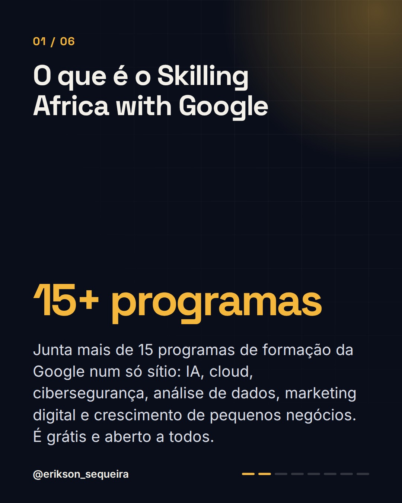

**Skilling Africa with Google: plataforma grátis de cursos de IA e negócio que funciona offline no telemóvel (foco Moçambique)** · pilar `negocios` · formato `ferramenta-gratis`





### Legenda

```
Aprender IA sem gastar um megabyte de dados móveis já é possível, e é grátis.

A 2 de novembro, a Google lançou em toda a África o Skilling Africa with Google, um único sítio onde estão mais de 15 dos seus programas de formação. A meta é ambiciosa: dar competências digitais e de IA a 3 milhões de pessoas no continente até 2030, segundo Alex Okosi, diretor-geral da Google em África.

Porque é que isto importa? Segundo o relatório da GSMA citado pela Ecofin, 63% da população africana vive em zonas com cobertura de internet móvel mas não a usa. E, num estudo da União Africana e da OCDE, só 9% dos jovens dos 15 países analisados tinham competências digitais básicas. O problema não é só a rede. É também o custo dos dados e a falta de formação.

Por isso, o ponto forte da plataforma é o modo offline: descarregas no Wi-Fi do trabalho, da universidade ou de um café e estudas depois no chapa, em casa ou onde quiseres.

A minha dica: se tens um pequeno negócio, começa pela Hustle Academy. Se procuras trabalho remoto, vai para análise de dados ou marketing digital. Quinze minutos por dia chegam para começar. Os crachás verificáveis que vais ganhando servem para mostrar a clientes e empregadores.

Ainda não há versão em português, mas isso também é uma forma de treinares o inglês técnico, a língua de muitas vagas remotas.

Que área escolhias primeiro? Diz-me nos comentários.

Partilha com quem precisa, sobretudo com aquele amigo que diz que não estuda por causa dos dados.

O SCOUT tira-te as dúvidas do curso. Para saberes qual é a próxima ferramenta grátis, segue @erikson_sequeira.

Fonte: Google, Ecofin Agency, iAfrica

#inteligenciaartificial #cursosgratis #empreendedorismo #mocambique #transformacaodigital
```

### Fontes verificadas
- https://blog.google/intl/en-africa/unlocking-africas-ai-potential-introducing-skilling-africa-with-google/
- https://www.ecofinagency.com/news-services/0311-60388-google-brings-15-training-programs-onto-one-free-platform-with-offline-access
- https://iafrica.com/google-launches-free-skilling-africa-hub-with-offline-lessons-and-ai-study-companion/
- https://skillingafrica.withgoogle.com/

---
Comenta **ok** para publicar · **não** para descartar.