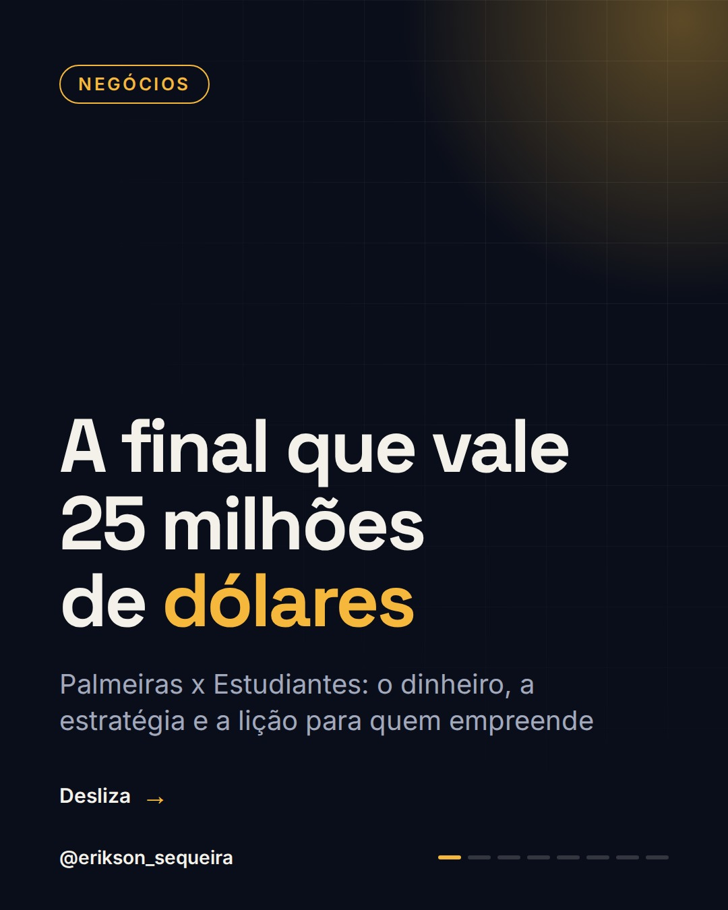
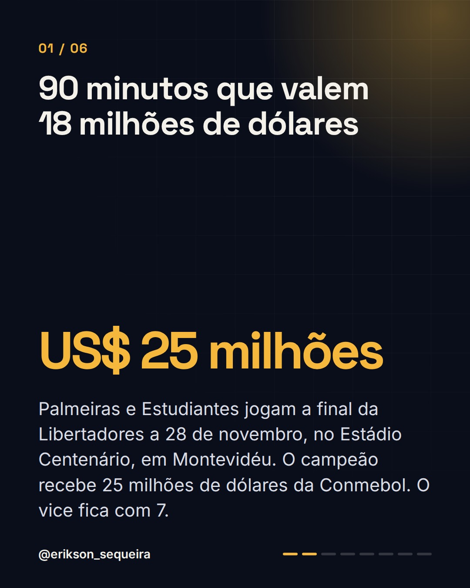
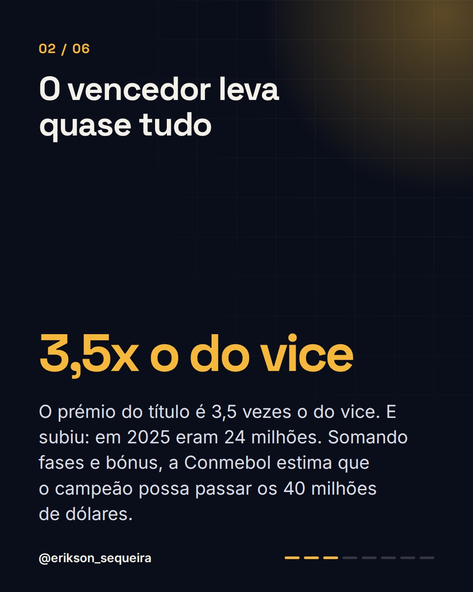
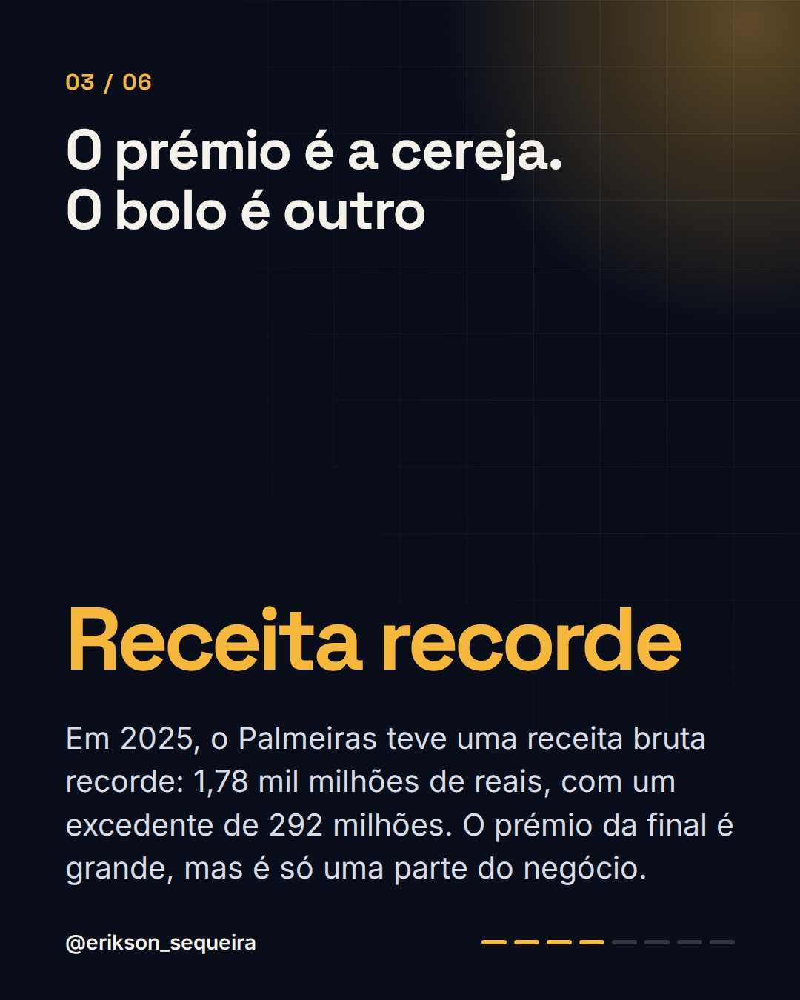
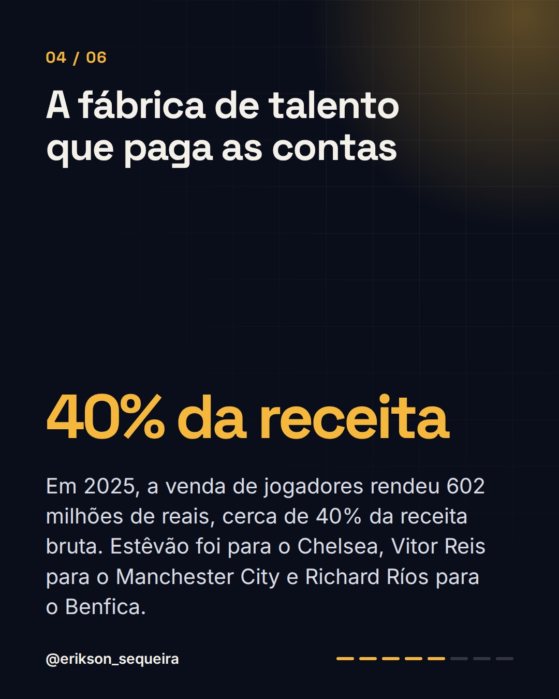
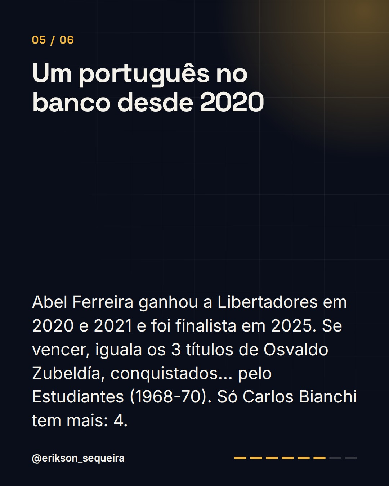
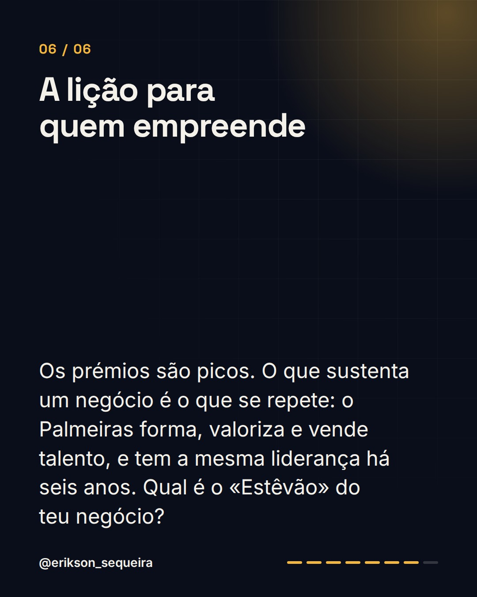

**Final da Libertadores 2026 (Palmeiras x Estudiantes): prémio de 25 milhões de dólares, modelo de negócio do Palmeiras e Abel Ferreira** · pilar `negocios` · formato `hype`










### Legenda

```
Esta final vale 25 milhões de dólares ao campeão, mas o Palmeiras ganha a maior parte do dinheiro longe do relvado.

Este sábado, 28 de novembro, Palmeiras e Estudiantes decidem a Libertadores num só jogo, em Montevidéu. A Conmebol paga 25 milhões de dólares ao campeão e 7 milhões ao vice. Numa só noite, a diferença é de 18 milhões.

O que me interessa mais é o modelo por trás. Em 2025, o Palmeiras faturou um recorde de 1,78 mil milhões de reais, e cerca de 40% disso veio da venda de jogadores. Primeiro o clube forma e dá minutos aos jovens. Depois valoriza-os e vende-os à Europa. E repete o processo todas as épocas. O título é um pico, a academia é receita recorrente.

Há outro ponto que muitas empresas ignoram: a estabilidade. Abel Ferreira, português, está no comando desde 2020. No futebol, onde se despedem treinadores à terceira derrota, isso é quase uma vantagem competitiva.

Como empreendedor cabo-verdiano, vejo aqui um espelho para os PALOP. Exportamos talento há décadas, no futebol e fora dele. A pergunta é quem fica com o valor de o formar.

Aplica isto ao teu negócio: separa o que entra uma vez (um contrato grande, uma época alta no turismo) do que entra todos os meses. É a segunda coluna que te deixa dormir.

E tu, no teu negócio, qual é a tua «academia»: o que crias uma vez e vendes muitas?

Guarda este post para a próxima vez que planeares o teu ano.

O campeão leva 25 milhões. Tu levas uma lição de negócio por post, de graça: segue @erikson_sequeira.

Fonte: Trivela, Brasil em Folhas, InfoMoney/Estadão Conteúdo, La Nación, Soccerway

#libertadores #palmeiras #empreendedorismo #negociosdofutebol #abelferreira
```

### Fontes verificadas
- https://trivela.com.br/america-do-sul/libertadores/libertadores-premiacao-titulo-valor/
- https://brasilemfolhas.com.br/2026/11/campeao-da-libertadores-de-2026-recebe-premio-recorde-de-us-25-milhoes/
- https://www.infomoney.com.br/?p=3256709
- https://www.lanacion.com.ar/usa/musleras-3-penalty-saves-lift-10-man-estudiantes-past-flamengo-into-libertadores-final-nid23102026/
- https://gol.conmebol.com/libertadores/en/news/2026-conmebol-libertadores-final-will-be-played-montevideo
- https://pt.soccerway.com/noticias/futebol-taca-dos-libertadores-libertadores-abel-visa-tricampeonato-sul-americano-e-recorde-no-palmeiras/pv12mJK6
- https://www.palmeiras.com.br/noticias/em-90o-jogo-junto-a-comissao-abel-conduz-verdao-a-segunda-final-da-libertadores-em-10-meses

---
Comenta **ok** para publicar · **não** para descartar.